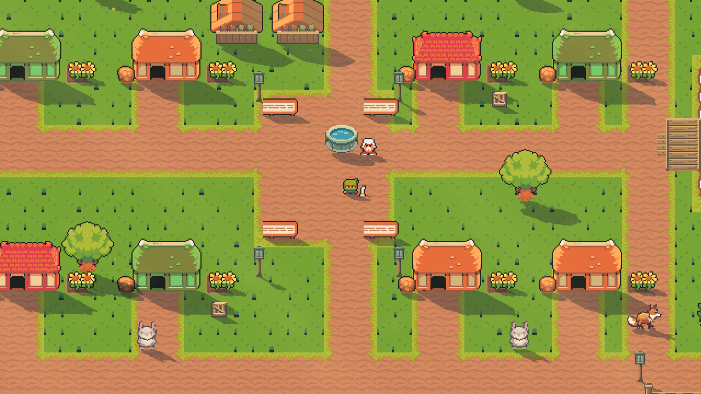
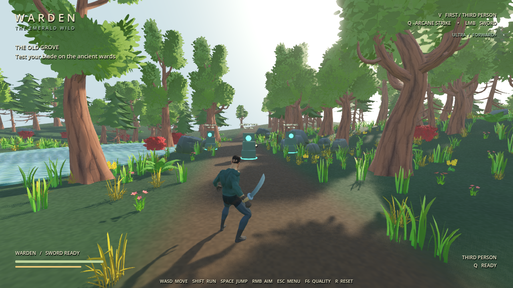
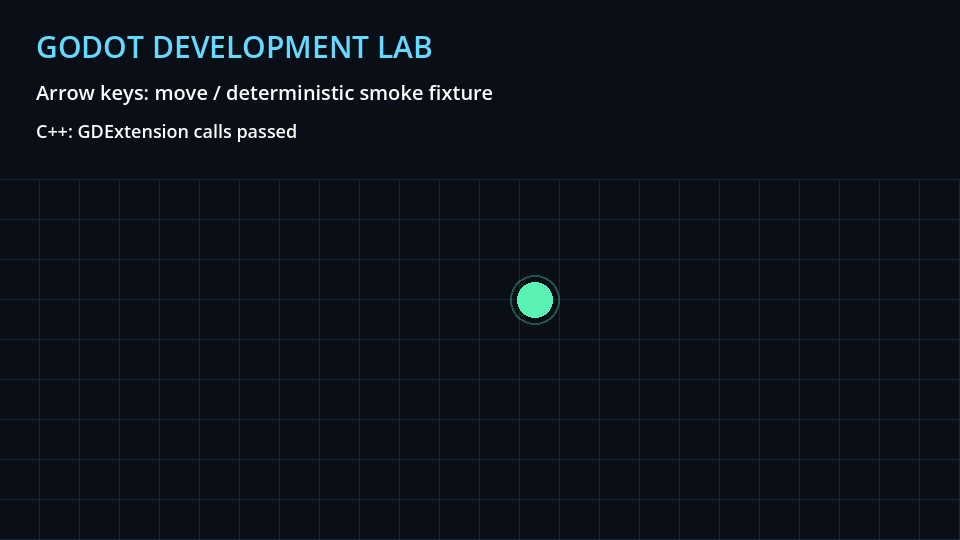

# Фонарщик — Тихая долина · новая 2D-игра

**Отдельный первый играбельный проект:** [инструкция и управление](lantern_game/README.md).
Открывать **`lantern_game/project.godot`** в Godot 4.7.2 и нажать F5.
Деревня с 12 домами, озером и фермой, окружающий лес, герой с пятью инструментами,
лисы/кролики, свет фонаря и портретный Z/X-диалог со странником. Без постоянного HUD.
Это исследовательская первая версия, ещё без интерьеров, боя и сбора урожая.
[Реальные кадры и коллизии](docs/evidence/lantern/) · [Полный крупноплановый аудит](docs/evidence/lantern-audit/REVIEW.md) · [CC0-источники](lantern_game/CREDITS.md).
[Скачать исправленную версию 0.1.2](https://github.com/maksummatatov10-spec1231/godot/releases/download/lantern-valley-v0.1.2/Lantern-Valley-Godot-Project.zip).
3D-игра ниже сохранена отдельно и не изменена этой работой.



---

# WARDEN — The Emerald Wild

**v0.2: камера, тело/тени в FPS, бег в обеих камерах, прогрев магии и полноценные меню.**
[Релиз v0.2](https://github.com/maksummatatov10-spec1231/godot/releases/tag/warden-forest-v0.2.0) · [Оптимизация и ограничения RX 580](docs/FOREST_OPTIMIZATION.md)

**Новая самостоятельная 3D-тестовая игра:** [проект и инструкция](forest_game/README.md).
Открывать **`forest_game/project.godot`**, не старый лабораторный проект `godot/`.
Лес днём, персонаж с мечом, первое/третье лицо, ходьба/бег/прыжок, серия ударов
и магия из предоставленных ассетов. [Реальные кадры и тесты](docs/evidence/forest-game/).



---

# Godot development lab — предыдущие технические проверки

Рабочий технический стенд для **Godot 4.7.2 stable**. Теперь проверены не только
headless-запуски: получены и просмотрены **настоящие скриншоты Godot**, а **C++
GDExtension** собрана и вызвана из GDScript как нативная альтернатива Rust.



Это подготовка инструментов, а не выбранный жанр или готовая игра.

## Текущий рендерер и плагины

**Forward+** — выбран для desktop и всех возможностей Terrain3D/SunshineClouds2.
Тихий fallback на OpenGL отключён: иначе облака исчезли бы без полноценной поддержки.
Это выбор совместимости, а не обещание максимального FPS на любом компьютере.
[Настройки, исправления, проверки и ограничения](docs/plugins/README.md).

**Обновление:** реальный Forward+ захват работает на GitHub Actions через
Xvfb + системный Mesa Lavapipe. Кадры игры и отдельного стенда открыты и просмотрены.
Это software Vulkan, не измерение аппаратного FPS. Локальный SwiftShader X11
surface по-прежнему не предоставляет. [Метод и ограничения](docs/GRAPHICS.md).

## Ранее проверено у агента

- Движок из предоставленного Google Drive архива: SHA-256 совпал с официальным
  GitHub digest; `--version` → `4.7.2.stable.official.ed1daf0bf`.
- Импорт сцены и headless smoke: проверка движения без ошибок.
- **C++ / godot-cpp 10.0.0 stable, API 4.7**: release-библиотека Linux x86_64,
  загрузка Godot, вызовы `CppProbe.add`, обычные значения и границы int32.
- Визуальный fallback **Xvfb + ANGLE/SwiftShader + EGL pbuffer**: два PNG 960×540,
  до и после движения через Input action; изображения открыты и осмотрены.
- Автопроверка положения игрока и области изменившихся пикселей.
- Тесты Python-инструментов, GDScript lint/format.

C++ и Rust могут давать сопоставимую нативную скорость, но точное равенство без
benchmark конкретного алгоритма не обещаем. В C++ нет Rust borrow checker;
правила памяти/lifetime и профилирование остаются обязательными.

## Быстрые команды в текущей среде

```sh
.venv/bin/python tools/check.py doctor
.venv/bin/python tools/build_cpp.py
.venv/bin/python tools/check.py smoke --require-cpp --test-input
.venv/bin/python tools/check.py visual --renderer gl_compatibility --portable-graphics --require-cpp
.venv/bin/python tools/check.py visual --renderer gl_compatibility --portable-graphics --require-cpp --test-input
.venv/bin/python tools/verify_lab_images.py
```

Результаты: `artifacts/lab.png`, `artifacts/lab-moved.png`, `artifacts/*.log`.
Два осмотренных кадра сохранены в `docs/evidence/`.
`tools/check.py` находит Linux-движок в `.tools/godot/` автоматически.

**Важно:** portable graphics — изолированный диагностический fallback для ограниченной
среды, с архивными X11-библиотеками, фиксированным размером и offscreen-поверхностью.
Это не production runtime и не тест физического GPU/монитора.
[Подробности, источники и ограничения](docs/GRAPHICS.md).

## Настройка на новом хосте

Godot **4.7.2 Standard**, Python 3.11+, для нативной сборки — компилятор C++.
На Linux достаточно GCC/G++ и стандартного toolchain; C++ build-скрипт сейчас
поддерживает **только Linux x86_64**. Windows/macOS-сборки потребуют своей настройки.
.NET для C++ не нужен.

```sh
python -m venv .venv
# Linux/macOS:
. .venv/bin/activate
# Windows PowerShell:
# .venv\Scripts\Activate.ps1
python -m pip install -r requirements-dev.txt
# Если Godot не найден в PATH:
export GODOT4_BIN=/absolute/path/to/godot
# PowerShell: $env:GODOT4_BIN = 'C:\Tools\Godot.exe'
python tools/check.py smoke
```

Для интерактивного запуска открыть `godot/project.godot` и нажать F5.
Стрелки двигают зелёный объект. До сборки расширений сцена работает на GDScript;
`--require-cpp` требует C++ явно, не пропускает проверку молча.

### C++

```sh
python tools/build_cpp.py
python tools/check.py smoke --require-cpp
```

Скрипт скачивает **официальный godot-cpp 10.0.0-stable по commit SHA**, проверяет
SHA-256, собирает SCons и только затем включает `godot/native_cpp/game_cpp.gdextension`.
Compiler G++ 12.2 в среде агента уже был установлен; скачаны bindings и SCons.
По умолчанию — release, для debug: `python tools/build_cpp.py --debug`.
Обе конфигурации используют один staging-путь; последняя сборка его заменяет.

`cpp/build_profile.json` пока включает RefCounted и OS. Для будущих игровых
классов расширим этот список. Для отключения расширения убрать сгенерированную
`godot/native_cpp/` и повторить импорт. Чужие готовые native-библиотеки не запускаем
без проверки происхождения: они имеют полномочия обычного исполняемого кода.

### Скриншоты

На полноценном Linux-хосте предпочтительны актуальные системные Xvfb/Mesa:

```sh
sudo apt-get install xvfb xauth libgl1-mesa-dri libglx-mesa0
LIBGL_ALWAYS_SOFTWARE=1 python tools/check.py visual --require-cpp
LIBGL_ALWAYS_SOFTWARE=1 python tools/check.py visual --require-cpp --test-input
python tools/verify_lab_images.py
```

На этой песочнице вместо APT подготовлен fallback:

```sh
python tools/bootstrap_graphics.py
python tools/check.py visual --renderer gl_compatibility --portable-graphics --require-cpp
```

Сначала прочитать [описание fallback](docs/GRAPHICS.md), особенно источники старых
библиотек и временную ссылку `/usr/bin/xkbcomp`. Не используем его на общем хосте
или для недоверенного контента. Он требует Linux x86_64, gcc, gh и, при отсутствии
системного xkbcomp, разрешение `sudo -n` на создание/удаление этой точной ссылки.
Xvfb и временная ссылка убираются после теста, в том числе при ошибке.

### Rust остаётся необязательным

Пример `native/` сохранён, но **Rust/Cargo здесь не установлены и не проверены**.
Для текущего проверенного нативного пути они больше не нужны.
Если позже решим использовать Rust на твоём хосте:

```sh
rustup show
cargo fmt --manifest-path native/Cargo.toml --check
cargo test --manifest-path native/Cargo.toml
cargo clippy --manifest-path native/Cargo.toml --all-targets -- -D warnings
python tools/build_native.py
python tools/check.py smoke --require-rust
```

`rust-toolchain.toml` выбирает 1.94.0; godot-rust закреплён на 0.5.5 / API 4.7.
`native/Cargo.lock` ещё не сгенерирован. После первой Rust-сборки нужно проверить
и добавить lockfile, затем включить `--locked`.

## Проверки и документы

```sh
python -m unittest discover -s tests -v
gdlint godot/scripts
gdformat --check godot/scripts
```

- [Последние обновления кода, API и правила разработки](docs/DEVELOPMENT.md).
- [Фактические результаты](docs/VALIDATION.md).
- [Реализация screenshot-проверок и ограничения](docs/GRAPHICS.md).
- `.github/workflows/validate.yml` — подготовленный CI для C++/системной графики;
  Rust запускается только вручную с `test_rust`. **Сам GitHub workflow ещё не запускался.**

## Ассеты и Blender

Получены и локально проверены оба архива. Вся игровая библиотека распакована **вне проекта**:
5821 файл, 2.857 GB с вложенными архивами. В проект установлены только три запрошенных плагина.
Blender 5.3 установлен отдельно, им проверены все 2773 пути моделей; 552 аудиофайла декодированы.

- [Пофайловый каталог, наборы и превью](docs/assets/INDEX.md).
- [Результаты аудита и восстановление внешней библиотеки](docs/ASSET_INTAKE.md).
- [Три плагина: установка, лицензии, исправления и ограничения](docs/plugins/README.md).

Не все модели имеют полные зависимости/одинаковые лицензии. Выбираем для игры только нужное,
после проверки отчёта и лицензии конкретного набора. Большие архивы и Blender не хранятся в Git.
